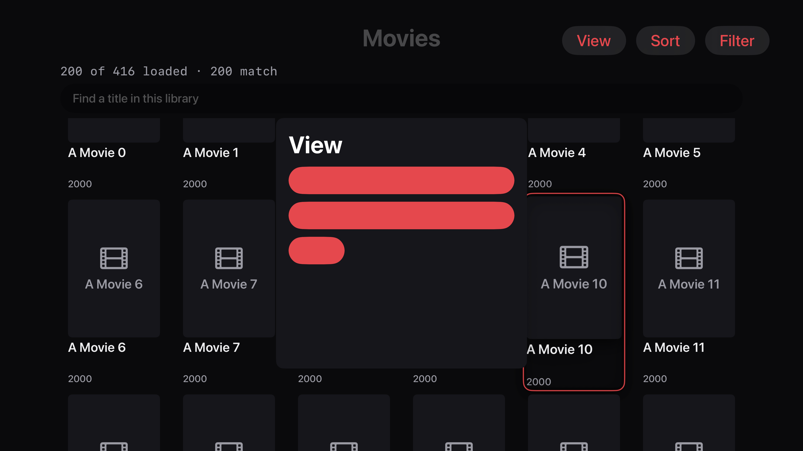

# Apple TV navigation — defects, proposed screens and a lasting release contract

**Status:** repairs built and native validation passed on `effort/apple-tv-navigation`.
All 26 required journeys and the effort gate pass; main promotion and the
explicit remaining physical/dynamic-state acceptance are open.
**Written:** 2026-10-15 · **Baseline:** `9eb7f6738647a7e963b17cfb3a2f77a594863c41`

This is the Apple TV follow-up to the [mobile usability audit](MOBILE-UI-USABILITY-AUDIT.md)
and [native layout work](NATIVE-LAYOUT-FOLLOWUP.md). It covers navigation,
focus, control placement, legibility and recovery across the television app.
The [rendering gallery](apple-tv-navigation/index.html) shows the proposed
screens. This document is the canonical project ledger until implementation
has its own ledger; its queue entry is in the [backlog](../features/PROJECT-BACKLOG.md).

The immediate diagnosis is concrete: the app can draw a menu in front of the
library without moving physical focus into it. Subsequent remote presses
continue navigating the movies behind it. Several unrelated screens reuse
that same menu. Separately, diagnostics added permanent buttons above live
video, bypassing the controls' visibility and focus ownership.

## 1. Evidence — what was inspected and what was actually reproduced

**User observations:** the movie View/Sort window is visible but reaching it
requires traversing a library of more than 400 movies; the Report a problem
button remains on screen and is badly placed. The user's report establishes
those experienced failures. It does not establish every other screen's failure.

**Native reproduction:** Xcode 27.0 (`27A266a`), tvOS 26.5 simulator, Apple TV
4K third generation. An isolated source copy uses the shipping `LibraryView`,
menu, coordinator and styles, with a synthetic 416-movie loader and a direct
library entry instead of production authentication. The grid had its first
200 titles loaded at capture. The UI test presses the native remote buttons:

1. Focus View and press Select. The View menu appears.
2. Native focus remains on the View toolbar button behind the menu.
3. Press Down three times. Native focus moves to **A Movie 10 behind the menu**.
4. The assertion that Rows, Grid or Close owns focus fails.

The screenshot also shows three red controls whose text is not visually
legible, although Rows, Grid and Close exist in the accessibility tree.
The first harness build failed on a complex synthetic Swift expression; an
explicit loop corrected that harness error. The second build succeeded and
ran the test to the expected focus assertion failure.



[Receipt](apple-tv-navigation/evidence/receipt.json) ·
[focus trace](apple-tv-navigation/evidence/focus-trace.txt) ·
[opening capture](apple-tv-navigation/evidence/modal-opening.png) ·
[reproduction patch](apple-tv-navigation/evidence/synthetic-harness.patch).
The reproduction patch is test scaffolding for an isolated copy, not a product
fix. No production server, user library or physical Apple TV was modified.
The isolated simulator was deleted after retaining the evidence.

**Subsequent owner clarification:** after that test completed, the coordination
chat relayed a build/install restriction whose scope the owner subsequently
clarified: only mobile app builds intended for installation on physical devices,
and those installations, must use committed source merged into `main`.
Simulator/emulator, CI and other builds not intended for physical-device
installation remain under the normal branch review/testing workflow, as does
non-mobile work. Do not reuse an unmerged-source mobile test build for
physical-device installation. No further app build/install was performed. The patch is retained
as historical evidence.

**Limits:** this was not a complete live walkthrough, a production login test,
a test of the full bottom-of-library workaround, or physical Siri Remote
swipe/hold acceptance. The rest is a review of current source and tests.
Absence of an explicit focus modifier alone is not proof that a native control
is broken. Runtime-dependent risks below remain labeled as such. No audit can
honestly promise to have found every possible navigation failure without the
full scenario matrix and physical acceptance.

**Evidence labels:** **N** = reproduced in the native synthetic harness;
**S** = behavior or missing route directly established by source;
**R** = plausible focus/layout failure needing runtime verification.
**P1** blocks or seriously disrupts a primary journey; **P2** harms usability
or leaves a reproducible regression gap. R priorities are proposed severity,
not a claim of a reproduced defect.

## 2. Screen inventory — every family has an explicit disposition

| Surface and states inspected | Current evidence / findings | Remaining acceptance |
|---|---|---|
| Connect, discovery, login, reconnect, loading | Source: auth scaffold, busy/disabled controls, root diagnostics; F11, F22, F26 | Discovery list growth, keyboard open/close, timeout, invalid credentials and recovery with a remote |
| Root tabs, hidden server features, stacked destinations | Native tab reentry steals focus into prior content; source: `HomeView`, path binding and scope synchronization; F05, F29, F30 | Every tab in both directions, feature disabled while selected, repeated Back, suspend/resume |
| Home Classic and Theater, Continue Watching, Next Up, Recently Added, Coming Soon | Source: shelves and Theater hero; F09, F27 | First/last card to adjacent rows, data refresh while focused, hero playback return |
| Libraries dashboard, category/library grouping, shared entry | Source: shared choice panel and shelf headings; F01–F03, F09 | Grouping open/select/cancel; See All from far end of every shelf |
| Movie/show/home-video collection, Rows/Grid, filters, sorting, title narrowing | Native View-menu reproduction; all other states source; F01–F05 | Rows and Grid at 0/1/416/5,000 items; every sort/filter, all poster sizes |
| Alphabet/year/resolution/date groups and View all | Source: scroll-only index and group view; F04–F05 | Jump then Down, return from group/detail, partial paging and disappearing group |
| Movie/video/audiobook details, versions and tracks | Source: hero, actions, body and choice panels; F01–F03, F07–F08, F28 | Long titles/track names, unavailable file, multipart audiobook, resume/start-over |
| Show, season and episode cards | Source: explicit TV Play-only episode card; F06–F08 | Find an episode's details and track/version choices without starting it |
| Search, empty/loading/results/failure | Source: result replacement and missing Retry; F10 | Keyboard cancellation, slow search, returning from detail, result removal |
| Local VOD player, hidden/transport/timeline/scrub/menu/info/failed | Source: input reducer and adapter already exist; F01–F03, F11, F27–F28 | Every state/input pair in the real UI, caption menu, report return, autoplay |
| Live TV On now, guide, all three layouts, filters and programme sheets | Source: substantial existing focus restoration; F01–F03, F15–F17 | Guide edges/time paging, zero channels, protected channel, refresh during focus |
| Live fullscreen, temporary guide, More, Info and diagnostics | Source: existing hide/reveal contract plus external report overlay; F11, F17 | First press only reveals, Back hierarchy, sheet close, reminder expiry |
| Library channels: browse, layouts, programme cards, fullscreen, watch-from-start | Source: separate native VideoPlayer presentation; F11–F14 | No-op future programme, controls disappearing, return to same channel, failures |
| Recordings, upcoming, saved, attention, skipped, rules, reminders, manual | Source: all seven views and row actions; F18–F21 | Long lists, destructive confirmation, rule reordering, empty/error, manual channel selection |
| Recording activity, detail and history | Source: dynamic rows and history; F18, F21, F28 | Recording ends or disappears while focused; read full history with remote |
| Settings, Live TV administration, Developer, Remotes & devices | Source: native menu pickers already used; F22, F26–F27 | Every setting and submenu, long readiness text, authorization failure, reset confirmation |
| Report creation, privacy choices, reproduction, local history and TV ZIP | Source plus existing diagnostic UI tests; F11, F23 | Open from each owner, cancel/close/reopen, QR scan from couch, return to opener |
| Shared sources, libraries, search/page loading, title detail and player | Source: separate browsing/player controls; F24–F25 | Offline source, load more, physical Play/Pause/Back, menu return, interrupted prepare |
| Sharing management and endpoint/assignment/export editors | Source: forms, sheets, confirmation paths and authorization handling | Read-only route review only; real admin changes, keyboard and nested-sheet focus unverified |
| Download/book reader and invitation acceptance screens | iOS-only branches; not TV destinations | No television implementation requested or inferred |

Primary sources are under [Apple Sources](../../clients/apple/Sources).
All numbered findings below link to the relevant file or function. The table
records source review breadth, not a claim of runtime coverage of every row.

## 3. Findings — browse, menus and details

### F01 · P1 · N/S — a visible choice panel does not own native focus

**Evidence:** [openModal](../../clients/apple/Sources/RemoteNavigationCoordinator.swift#L308)
sets the logical modal and requests nil focus. [RemoteControlModifier](../../clients/apple/Sources/RemoteNavigationViews.swift#L48)
only sets its binding true for a matching request; it does not make covered
controls unfocusable. [RemoteChoicePanel](../../clients/apple/Sources/RemoteNavigationViews.swift#L155)
registers order on appear but selects no initial target. The
[library overlay](../../clients/apple/Sources/LibraryView.swift#L102) leaves
its base active. The native reproduction above demonstrates the result.

**Reach:** View/Sort/Filter; dashboard grouping; pre-play Audio/Subtitles/Version;
local player tracks/quality; Live TV Guide time/Captions; shared player choices.
Reusing the component proves shared exposure, not identical symptoms on each.

**Fix:** one native modal presenter for this family. Present above the current
owner, make the covered surface ineligible for native focus and input, move
focus to the selected choice (otherwise the first enabled choice), then restore
the opener after dismissal. Keep companion commands routed through that same
presentation. `focusScope` or `focusSection` alone is not a modal barrier.
**Proof:** open each menu from its real opener; the first native focus after
presentation is inside, every direction stays inside, and Select cannot open
a background movie. Rendering R02.

### F02 · P1 · N — menu controls can be visually blank

**Evidence:** the native capture shows red fills without readable Rows/Grid/Close
labels. The panel uses `.buttonStyle(.bordered)` and inherits the red tint.
[Theme.swift](../../clients/apple/Sources/Theme.swift#L117) already documents
the same tvOS tint/label problem and provides `TVReadableButtonStyle`.

**Fix:** use a shared TV choice-row style that owns both foreground and fill;
show selection with a checkmark and focus with a distinct high-contrast outline.
Apply it to Close too. **Proof:** screenshot and visual inspection of every
choice focused/unfocused/selected/disabled in all themes and appearances on
supported tvOS versions. An accessibility name alone does not pass. R02.

### F03 · P1 · R — Back can be delivered outside the menu

**Evidence:** [RemoteChoiceExitAdapter](../../clients/apple/Sources/PlayerRemoteAdapter.swift#L144)
is installed on the panel. F01 leaves native focus in the underlying sibling;
that panel is not the focused view's ancestor. Thus its exit handler cannot be
assumed to receive Back. The exact resulting pop/hide/exit differs by host and
has not been reproduced here.

**Fix:** the top presented owner handles Back once. Close its menu first,
without also popping the page or hiding/exiting the player. **Proof:** Back
immediately after opening and after every choice position; repeat with rapid
presses during presentation and dismissal. R02.

### F04 · P2 · S/R — Jump scrolls content but does not hand focus to it

**Evidence:** [LibraryView](../../clients/apple/Sources/LibraryView.swift#L65)
changes `selectedGroup` and calls `scrollTo`; it does not request the first
item's focus. The selected-group indicator also does not follow manual
scrolling. The existing jump test uses iOS taps, not a TV remote.

**Fix:** Select on Jump to M scrolls to and focuses M's first available item
after realization. Preserve a separate last index choice for returning to the
index. Clear or update the marker when sort/filter removes the group.
**Proof:** choose an offscreen group, press Select then Right; focus moves among
that group's items, not along the alphabet. Repeat after manual scrolling. R01.

### F05 · P2 · R — long-library escape and restoration lack a TV contract

**Evidence:** collection/group grids have no explicit physical focus bookmark
or bounded route from deep content to tools. They rely on native geometry and
retained view state; semantic remote restoration is a separate mechanism.
[LibraryGroupView](../../clients/apple/Sources/LibraryView.swift#L304) reloads
its coordinator on arrival. Sort/query/filter can replace the visible targets.
This does not prove every Back restoration fails, but the current tests do not
establish it works.

**Fix:** bookmark item identity, group and scroll location. Add a persistent
Library tools target at the grid/shelf's left boundary: at most six Left presses
in a six-column grid reach tools at any depth. Up still means the preceding
row; Back still pops the destination. Tools return to the saved item. When an
item disappears, choose the next surviving neighbor, then previous, then the
empty-state action. **Proof:** item 1/200/416, View all, detail, playback, sort,
filter and refresh all have explicit landing assertions. R01.

### F06 · P2 · S — season episode cards have no details action on TV

**Evidence:** [EpisodeCard](../../clients/apple/Sources/Components.swift#L320)
has a single television Button mapped to Play. The copy-to-detail link exists
only in the non-TV branch. From that season shelf there is no direct episode
details route to inspect its full description or choose tracks before playing.
Searching separately is a workaround, not a replacement for that route.

**Fix:** preserve Select-to-play if that remains the product contract; add a
visible shelf-level “Episode options” action tied to the focused episode, with
Details, Audio/Subtitles and Start over. Do not require a hidden long press.
**Proof:** reach episode details from its season without starting playback;
Back restores the exact episode. R03.

### F07 · P2 · S — truncated synopses cannot be expanded

**Evidence:** [tvPlayableContent](../../clients/apple/Sources/DetailView.swift#L1508)
limits synopsis to two lines; the TV series header limits it to five. Neither
has a Read more action. The movie body contains track facts/editions/children,
not a complete synopsis destination.

**Fix:** an About action opens the full synopsis in a readable scrolling sheet,
with explicit focusable text regions on TV. **Proof:** read the last paragraph
of a long synopsis and close back to About. R03.

### F08 · P2 · R — long action labels can exceed the fixed detail hero

**Evidence:** [TV playable hero](../../clients/apple/Sources/DetailView.swift#L1497)
has a 980-point copy area, fixed height and clipping. Its second HStack holds
full Audio and Subtitles summaries plus Version, without adaptive wrapping.
Long language/codec/track names can compete with controls and hide choices.

**Fix:** short stable action labels with selected values on secondary lines;
put Versions and detailed track facts in the same options sheet. Bound the
visible hero copy, not the reachability of its actions. **Proof:** two-line
title, long synopsis, resume/start-over, multiple versions and longest track
names simultaneously, at 1080p and 4K. R03.

### F09 · P2 · S — Home and Libraries failures offer no TV Retry

**Evidence:** [HomeDashboard and LibrariesDashboard](../../clients/apple/Sources/HomeView.swift)
render `ContentUnavailableView` on `homeError`. Refresh gestures are iOS-only;
the empty library text says “pull to refresh” on TV too. Foreground refresh
exists but is an indirect recovery route.

**Fix:** Retry next to the error, preserve any usable cached shelves, and use
TV-specific empty-state copy. **Proof:** disconnect/recover the fixture; Retry
restores content without app relaunch or leaving the app. R04/R10.

### F10 · P2 · S/R — search failures require editing, and refresh removes results

**Evidence:** [SearchView](../../clients/apple/Sources/SearchView.swift#L58)
shows an error without Retry; `.task(id: query)` runs again only when the query
changes or the view task restarts. `searching` replaces the results with a
spinner. Its TV search field scrolls with results. Native focus behavior when
an arriving query removes the focused card remains unverified.

**Fix:** fixed search field, keep previous results with a loading status until
the replacement arrives, explicit Retry/Clear, and identity-based restoration.
**Proof:** empty query, no matches, error then Retry unchanged, out-of-order
responses and Back from a deep result. R05.

## 4. Findings — playback, Live TV and channels

### F11 · P1 · S — diagnostics floats above video outside the controls

**Evidence:** [Live TV fullscreen](../../clients/apple/Sources/LiveTvView.swift#L2392)
and [library-channel fullscreen](../../clients/apple/Sources/LibraryChannels.swift#L936)
attach Report a problem as an unconditional top-trailing overlay. It is not
conditioned on chrome visibility and has no place in those focus targets.
The channel player also puts Return/Pause/Stop in the same corner. Local VOD
instead includes reporting in its control row and failure view; the unauthenticated
root has a separate bottom-trailing button. This is not one global button on
every ready screen, but several independently placed copies.

**Fix:** Help → Report a problem in Settings; More → Report a problem in every
player; a secondary action on actual failure panels; contextual Help on
connection screens. No persistent report button over healthy video. Capture
the incident promptly when selected and retain the existing privacy/export
flow. **Proof:** after idle, no report or unrelated control is visible or
focusable; reveal → More → Report → Close returns to More with playback intact.
R06/R09/R10.

### F12 · P1 · S/R — library channels uses a separate fullscreen control system

**Evidence:** [channelFullscreenSurface](../../clients/apple/Sources/LibraryChannels.swift#L1005)
embeds interactive `VideoPlayer` plus permanent Return/Pause/Stop controls.
It has no integration with the finite/live custom input adapters. Watch from
start adds another permanent Return to channel button above `PlayerView`.
Duplicate control ownership is source-confirmed; exact AVKit/custom focus
collisions require device verification.

**Fix:** share the TV playback chrome/presentation contract while preserving
the library channel's existing session/controller. Return to channels is a
visible-chrome action; leaving fullscreen retains the live channel; Stop is
explicit. Watch-from-start's return action belongs in the player's controls.
**Proof:** same hidden/reveal/menu/Back behavior for local, live, channel and
shared playback, including transitions back from personal playback. R06.

### F13 · P2 · S — future library-channel programmes are buttons with no action

**Evidence:** [channelList](../../clients/apple/Sources/LibraryChannels.swift#L1054)
sets `focusedProgrammeId` on Select, then tunes only if the programme is on
now. Future/past cards have no explanatory action. The “Focused programme”
accessibility value reflects the last selection, not native focus movement.

**Fix:** Select opens programme details for non-current programmes, with timing
and applicable actions; current programmes can retain Watch. Observe actual
focus for focus labels. **Proof:** future programme Select changes visible UI
and explains availability, without tuning the current programme accidentally.
R07.

### F14 · P2 · S — channel layout changes by an undisclosed cycle

**Evidence:** [library-channel toolbar](../../clients/apple/Sources/LibraryChannels.swift#L886)
cycles three layout strings every press. The label describes the current
layout, not a choice list or the next action. Live TV uses a layout panel.

**Fix:** one layout picker with named choices and a checkmark, shared with the
Live TV presentation vocabulary. Restore the Layout opener on close. **Proof:**
choose each layout directly, cancel without changing it, retain the programme.
R02/R07.

### F15 · P2 · R — the Live TV toolbar can exhaust its width

**Evidence:** [liveToolbar](../../clients/apple/Sources/LiveTvView.swift#L2778)
puts On now/Guide/Recordings, a variable summary, Favorites, Search (including
the query), Layout, Guide time, Captions and More in one 48-point HStack.
The two new text buttons use default styling rather than the compact TV style.
There is no fitting alternative or scrolling toolbar.

**Fix:** keep On now/Guide, Search and More at the top. Put guide-time controls
beside the guide, captions in playback options, layout/favorites in the
appropriate menu; keep recordings reachable through the existing destination.
Show full values in menus, not in growing toolbar labels. **Proof:** longest
query/status and recording count together at both TV output sizes. R07.

### F16 · P2 · S/R — new Live TV controls bypass its focus bookkeeping

**Evidence:** Guide time and Captions have semantic `.remoteControl` keys but
no cases in [FocusTarget.isToolbar](../../clients/apple/Sources/LiveTvView.swift#L2048).
They do not update `lastToolbarFocus`, which `returnToToolbar()` uses. Entering
content after one of these can return to an older toolbar control. The exact
native path needs reproduction.

**Fix:** register every toolbar action with the shared focus owner, or remove
it from that toolbar as in F15. No separate native and semantic identity lists
that can silently diverge. **Proof:** leave and re-enter content from every
toolbar control; restore that exact control. R07.

### F17 · P2 · R — reminder actions are not part of fullscreen focus ownership

**Evidence:** [ReminderOverlay](../../clients/apple/Sources/ReminderOverlay.swift)
is an independently focusable set of Watch/Record/Dismiss buttons; its expiry
removes them. It has no focus restoration and its comment relies on platform
Back dismissal. Live fullscreen's keyed reveal/pill controls and Back reducer
do not have a reminder state. Do not assume the comment proves dismissal.

**Fix:** noninteractive reminder toast while chrome is hidden; reveal exposes
a named reminder action. Opening its action sheet freezes chrome auto-hide;
expiry closes the sheet safely and restores its opener/fallback. Do not steal
focus on arrival. **Proof:** reminder appears/expires while scrubbing, in a
menu, focused on Dismiss and during playback; one press causes one action.
R06/R07.

## 5. Findings — recordings, settings, support and shared media

### F18 · P2 · S/R — recording confirmation appears away from its opener

**Evidence:** [DvrRecordingsPanel](../../clients/apple/Sources/DvrRecordings.swift#L689)
inserts delete/stop confirmation above the scrolling content, with no focus
handoff. `delete_file_required` can reveal it after a server round trip while
the viewer remains deep in the list. Detail stop confirmation is another inline
HStack. Reading it visually does not prove the remote reaches it.

**Fix:** one native confirmation sheet, Cancel/Keep as initial focus, explicit
recording title and consequence; close to the same row or its neighbor after
deletion. **Proof:** confirm/cancel from the final row in a long list, delayed
response, long title, repeated Select and Back during dismissal. R08.

### F19 · P2 · S — deleting a series rule has no confirmation

**Evidence:** [ruleRow](../../clients/apple/Sources/DvrRecordings.swift#L978)
places Delete next to ordering and enable controls; it calls `deleteRule`
directly. A navigation mistake can remove a recording rule.

**Fix:** put secondary row actions in an options sheet and confirm rule
removal. Preserve fast non-destructive enable/reorder actions. **Proof:** one
stray Select cannot delete a rule; Cancel preserves it. R08.

### F20 · P2 · S — manual recording asks TV users for an internal channel ID

**Evidence:** [manualRecording](../../clients/apple/Sources/DvrRecordings.swift#L1005)
requires a nonempty “Channel ID” TextField. No lineup picker explains or
supplies that identifier. TV time choices are limited to Now/5/15 minutes and
30/60/90/120-minute durations despite copy promising an exact time range.

**Fix:** searchable channel-number/name picker and clearly labeled start and
duration choices; either support exact scheduling or describe the actual
limits. **Proof:** schedule with only the remote and displayed channel names,
without copying an internal ID from another app. R08.

### F21 · P2 · R — DVR rows mix unstyled links with strongly styled actions

**Evidence:** saved/schedule/activity links in
[DvrRecordings.swift](../../clients/apple/Sources/DvrRecordings.swift#L910)
use `.buttonStyle(.plain)` without a local TV focus treatment, while adjacent
DVR buttons use a custom plate. Long rule rows contain five separate actions.
Whether the runtime supplies an adequate focus cue for each plain link must
be visually checked.

**Fix:** one clear focus treatment; make the whole title row a details target,
with secondary actions in its details/options surface. Label reorder actions
“Move earlier/later” rather than only triangles. **Proof:** a viewer can
identify the selected title/action from a screenshot and reach every action
with no diagonal navigation guess. R08.

### F22 · P2 · S — Help and routine settings sit below a long mixed form

**Evidence:** [SettingsView](../../clients/apple/Sources/SettingsView.swift)
is one scrolling Form covering playback, appearance, administration, sharing,
account, remotes, Developer, Help and About. Help is near the bottom. The
connection root solves discoverability by floating reporting elsewhere.

**Fix:** TV category navigation with Playback, Appearance, Live TV, Sharing,
Account, Remotes, Help, Developer and About; each preserves its focused setting.
Place Help among the first visible category choices. Connection errors expose
Help alongside Retry without a permanent unrelated overlay. **Proof:** Help
and a playback preference have bounded routes independent of readiness text
length; Back returns to the category. R09/R10.

### F23 · P2 · S — reporting is a diagnostics workbench before it is a TV flow

**Evidence:** [DiagnosticReportView](../../clients/apple/Sources/DiagnosticReportView.swift#L326)
contains capture, category, description, privacy, export, reproduction,
connection checks, administrator snapshot, history and events in one Form.
Moving events after actions was a useful previous repair, but the primary
phone/ZIP handoff still competes with many advanced actions. Settings Help
still advertises sending to support, while the current ordinary UI exports ZIPs.

**Fix:** capture immediately, then show “Save on phone”, a concise privacy
summary and Done. Keep advanced checks/history on separate routes. Keep local
export explicit, preserve cancellation/revocation and saved-draft behavior,
and describe the actual ZIP attachment flow. **Proof:** capture → QR → Close
from every player; export is never automatic; existing reporting tests remain
valid and gain exact opener restoration. R09.

### F24 · P2 · S/R — shared playback has a different TV interaction model

**Evidence:** [SharedLibraryDetailView](../../clients/apple/Sources/SharedLibrariesView.swift#L292)
opens a sheet containing [SharedPlayerView](../../clients/apple/Sources/PlayerView.swift#L3780).
That view places a noninteractive video surface, status text, a permanent
control HStack and Close in a VStack. It does not attach the local player's
physical Play/Pause/Back adapter. The controls can be selected individually,
but equivalence of physical transport keys is not established.

**Fix:** reuse TV chrome and input presentation while retaining the shared
controller's authorization and command ownership. Keep Source visible in
details/options; do not route shared commands through local playback APIs.
**Proof:** physical Play/Pause, reveal, Back, menu and return behavior matches
the other TV players; revocation still stops the authorized session. R06/R11.

### F25 · P2 · S — shared menu restoration names unregistered openers

**Evidence:** [SharedPlayerControls.openChoices](../../clients/apple/Sources/PlayerView.swift#L3905)
uses `shared:quality`, `shared:audio`, `shared:subtitles` as return keys. Those
opener buttons have accessibility identifiers but no matching `.remoteControl`
registration. Closing the panel requests a focus key no opener observes.

**Fix:** unify control identity and restoration registration, then verify
actual focus acknowledgment after dismissal. **Proof:** Quality/Audio/Subtitles
Select or Back lands on its exact opener, including busy settlement. R02/R11.

### F26 · P2 · S — remote registration reset acts immediately

**Evidence:** [RemoteDeviceSettingsView](../../clients/apple/Sources/RemoteDeviceSettingsView.swift#L34)
resets TV registration/revokes all paired phones on one Select, without a
confirmation. Per-device revocation is also immediate. This is consequential
UI next to routine management controls.

**Fix:** explicit confirmation showing the affected device(s), default Cancel;
post-action focus returns to the remaining list or Refresh. **Proof:** a single
Select only opens confirmation; Back cancels; rapid repeat does not cascade.
R09.

### F27 · P2 · S/R — focus presentation varies, and reduced motion is untested

**Evidence:** [Theme.swift](../../clients/apple/Sources/Theme.swift) uses a
four-point focus ring for readable buttons, a one-point ring for player icons,
and different lift/glow treatments for posters and shelf actions. New menus
bypass those styles. These styles contain unconditional scale animations and
no explicit Reduce Motion branch; resulting device accessibility behavior has
not been verified. Selection and focus can both use the same accent.

**Fix:** common focus tokens per control size, persistent checkmark for selected
values, clear disabled state, and a reduced-motion variant that retains the
focus outline without lift/animation. **Proof:** focus remains distinguishable
from selection in every theme, dark/light, Reduce Motion and VoiceOver. R01–R11.

### F28 · P2 · S/R — informational pages need a deliberate readable focus path

**Evidence:** track facts and recording history include long runs of plain
Text inside scrolling content. They do not all use the explicit `.focusable()`
reading treatment already present in
[PlaybackInfoPanel](../../clients/apple/Sources/PlaybackInfoPanel.swift#L197)
and diagnostic event previews. At couch distance, missing a reachable scroll
anchor can make below-fold text effectively inaccessible. Separately,
PlaybackInfoPanel resets focus to Close on every mode change, moving it off
the Standard/Details/Debug choice the viewer just selected.

**Fix:** focusable text blocks where scrolling requires them; keep focus on the
selected info mode, use Close only for initial entry if that is the agreed
rule. **Proof:** reach the final history/facts line and switch info modes
without being moved to Close. R03/R08/R09.

### F29 · P1 · S — current release evidence does not enforce TV journeys

**Evidence:** [LibraryRowsNavigationTests](../../clients/apple/UITests/LibraryRowsNavigationTests.swift#L1)
is entirely `#if os(iOS)`. [TVPhysicalInputTests](../../clients/apple/UITests/TVPhysicalInputTests.swift)
contains useful settings/playback/captions/paging tests, but requires a signed-in
physical device and named media. Its library test still expects Category/Library
segmented buttons although the current dashboard uses a Group by choice panel.
[project.yml](../../clients/apple/project.yml#L239) puts TV UI tests only in the
separate physical scheme; [make apple-test](../../Makefile#L1882) runs the ordinary
unit-test schemes. The effort and ordinary fast lanes compile Apple code but
do not drive focus journeys. Earlier layout docs explicitly left moving focus
and hardware acceptance open.

**Fix:** the enforceable contract in §7. Compile, reducer tests and static
screenshots must never be reported as navigation acceptance. Update stale
physical tests to the actual UI before treating their existence as protection.
**Proof:** deliberately remove modal focus entry in a control branch; the
required simulator journey fails and prevents qualification. R12.

### F30 · P1 · N/S — returning to a root tab steals focus into its content

**Evidence:** the shipping-route fixture test returned from Movies to Libraries,
focused its root tab, moved Left to Home, then Right to Libraries. The next
native focus was Movies' See All button rather than the Libraries tab. No Down
or Select was issued. `synchronizeRoute()` requested the stored content target
on a tab change, interrupting native horizontal tab navigation.

**Fix:** retain the content bookmark, but do not request it while switching
root tabs. Down enters content through native spatial navigation. Returning
from a destination within the same tab still restores its opener. **Proof:**
all enabled tabs in both directions after visiting content, plus detail Back
restoration and feature-removal fallback. This new finding comes from the
implementation's whole-app tests, not the original source-only audit.

### F31 · P1 · N — hidden playback paints a white focus box over video

**Evidence:** after build 239 was installed, the owner reported a white rounded
box centered on playing video which disappeared when controls appeared. The
retained native hidden-video capture contains the same box. The earlier visual
review missed it: native focus assertions passed without checking whether the
focus target painted visible chrome. The new screenshot assertion fails on the
old implementation with 148 bright pixels in the solid-black fixture's center.

**Fix:** the shared reveal target keeps its native Button and remote routing,
but uses an explicit label-only ButtonStyle. tvOS PlainButtonStyle paints a
focused bezel even when its label is clear and focus effects are disabled.
Movies, Live TV, library channels and Shared playback all use this target.

**Proof:** each of the four existing native playback journeys now checks the
actual screenshot pixels after asserting native hidden-target focus, then
continues through reveal, More/report and exact Back/session restoration.
The black MP4 and HLS fixtures make visible control chrome a measurable
failure. Earlier 26-journey receipts remain input evidence; they do not prove
this missing visual assertion. All four corrected journeys pass, and the hidden movie and Live captures were
visually checked. The corrected build 239 is installed on the paired Apple TV.
Final promotion stays held until the correction and the updated gate pass.

### F32 · P0 · N — full Live TV guide stalls and loses visible focus

**Evidence:** the owner supplied a physical-TV photograph of the 77-channel
lineup, reported invisible focus and sluggish navigation, then clarified that
the guide nearly froze the entire UI. A native shipping-route fixture with 77
channels reproduces a tens-of-seconds accessibility stall on guide entry. The
eager grid realizes every channel/programme control, while scroll geometry
changes update the grid. The two-channel playback fixture did not exercise
that load. The photograph also shows a large idle preview, clipped bottom rows,
a selected-segment background extending into the safe area, and a timeline
still anchored to the time the app opened.

**Implemented repair:** realize guide rows lazily, use a vertical TV
viewport with explicit time paging, remove per-scroll origin publication on TV,
keep one focus binding per cell and toolbar control, and route each direction
from the control receiving it. Toolbar Down/Select records its explicit origin;
transient native arrivals cannot overwrite that bookmark. Up through programme
actions and closing a choice sheet restore their respective exact openers. The first lazy-row trial eliminated the long entry stall but
exposed native focus moving before the outer custom direction handler; that
failed trial is retained. Use a white focus outline without zoom, a compact
detail stage with no idle preview, and clock-following until the viewer
explicitly pages away from Now.

**Validation:** the final isolated native run passes all three Live TV journeys.
The 77-channel fixture mixes half-hour and two-hour programmes and traverses
every row down and back without changing the vertical time anchor. Every step
requires the actual focused programme to fit inside the viewport within two
seconds, with a three-second bound including the press and native queries. The
last programme's action sheet restores its cell. Guide time closes to its exact
opener, and Down into content followed by Up returns to that same toolbar
control. The full traversal takes 122.63 seconds; all three journeys take
286.87 seconds. First/last-row and toolbar-return renders were inspected.
All 1,099 Apple TV unit tests and iOS simulator compilation pass.

The first saved-account physical traversal passed on the real 77-channel
lineup (126.99 seconds), with visible focus throughout and Back returning to
the root tab. Later faster-input checks caught a redundant scroll resetting
the viewport, and mixed-duration checks prompted the stable time anchor. The
final guide leaves completed native moves alone, reserves an opaque heading
outside the scroll content, and keeps channel labels inside their own column. Physical screenshots exposed
clipped diagnostic badges; TV guide rows now show station identity only, with
technical formats retained in stream information.
The required suite now includes both full-lineup guide journeys. Failed
attempts remain retained; neither missing tests nor skipped journeys qualify.

**Physical acceptance:** the final saved-account device repeat passes all
77 channels down and up, visible focus, a three-second response bound per
step, no future-programme drift and Back to the root tab (135.38 seconds).
First/last-row captures were inspected; a final visual cleanup removes codec
badges clipped inside the channel column. Additional fullscreen-guide open/Back and Up/Close checks caught requests
being sent to the covered browser instead of the mounted player focus owner.
The player controls and guide Close now own those requests inside the cover.
The extended Live playback journey passes both Back and Up/Close, reporting,
a two-second bound for Back-to-hidden-video (shorter than auto-hide), and
return to the original channel with exactly one tuner session. Its retained
native session takes 123.53 seconds. More now explicitly owns its Back; relying
on native sheet dismissal had left the next playback Back unhandled. The combined 28-journey repeat and mandatory promotion gate remain open;
this device result does not close the remaining whole-app acceptance matrix.

## 6. Proposed renderings — consistent interaction before decoration

The [gallery](apple-tv-navigation/index.html) includes twelve annotated design
plates. They are proposals with synthetic titles, not screenshots of repaired
SwiftUI. The native failure captures are labeled separately. The same choices
apply to each screen family, rather than adding a bespoke menu to each page.

| Plate | Proposed experience | Findings addressed |
|---|---|---|
| R01 · Library | Stable page tools, bounded left-edge access, grid position retained | F04–F05, F27 |
| R02 · Choice sheet | Selected choice receives focus; covered content inert; Close/Back restores opener | F01–F03, F14, F25 |
| R03 · Details and episode options | Short action labels, About, explicit episode details/track route | F06–F08, F28 |
| R04 · Home | Familiar tabs/shelves, readable focus, Retry above retained content | F09, F27 |
| R05 · Search | Fixed query and Retry; retained results; predictable result return | F10 |
| R06 · Playback | Quiet picture, one revealable control owner; reporting inside More | F11–F12, F17, F24 |
| R07 · Live and channels | Compact toolbar, guide-time controls by guide, real programme actions | F13–F16 |
| R08 · Recordings | Title-first rows, readable detail/actions, owned confirmation, channel picker | F18–F21, F28 |
| R09 · Settings and Help | Categories; TV-first phone handoff; advanced diagnostics separate | F22–F23, F26–F28 |
| R10 · Connection recovery | Retry/change server/Help together, keyboard returns to opener | F09, F11, F22 |
| R11 · Shared title | Same detail/playback grammar with explicit Source and its own controller | F24–F25 |
| R12 · Navigation acceptance | Visible coverage/release decision example, not a product screen | F29 |

### 6.1 Implementation comparison, October 15

Review the actual native captures alongside the plates. The synthetic fixtures
have blank artwork and deliberately long text; the plates use illustrative
artwork. Neither artwork differences nor passing assertions excuse clipped
labels, invisible focus or an unreachable action. The comparison below records
observed behavior and remaining limits, not pixel-for-pixel equivalence.

| Plate | Implemented behavior / retained native evidence | Disposition |
|---|---|---|
| R01 | Tools remain in a fixed left sidebar. Grid/Rows at 416 and 5,000 titles reach tools within six Left presses and View within three Up presses; Right restores the exact title. | Deliberate layout adjustment: View/Sort/Filter/Jump are together in the sidebar instead of split between top and left controls. Native captures inspected. Rows reserve focus clearance, and Up from the first poster reaches the readable View all action; group Back restores that action. |
| R02 | Selected value owns native focus; directional movement stays in the panel; Back returns to the exact opener. | Native View, Sort, Filter, grouping, channel layout and Shared Quality journeys pass individually. |
| R03 | Local movie About reaches the final reading region and returns to About, then the same movie. Episode details open without starting playback. | Native individual journeys pass; long text uses bounded focusable reading regions. |
| R04 | Failed foreground refresh keeps the shelf, shows Retry and returns focus to the retained title after success. | Native lifecycle journey and actual capture inspected. |
| R05 | Search retains its query through failure/Retry and restores the selected result after detail. | Native journey and final query, Retry and result-return captures inspected; explicit TV text contrast remains readable on the dark background. |
| R06 | Movie, Live, channel and Shared players hide chrome, reveal without unintended activation, put reporting inside More and restore the opener. | Native individual journeys pass. Shared keeps a direct Quality shortcut; its choices use the same owned presentation. This is a functional variation from the illustrative More layout. |
| R07 | Compact Live toolbar; named channel actions; channel layouts use explicit choices; future programmes open information. | Native Live/channel journeys pass individually; Live browse and fullscreen captures inspected. Guide paging and reminder expiry are separate outstanding matrix rows. |
| R08 | Title-first recording row spans the content width, opens detail and returns exactly; rule confirmation starts on Keep; manual scheduling uses named channels. | Native journey and actual row/confirmation captures inspected. Destructive commit and disappearing-row stress remain separate from safe cancellation. |
| R09 | Help is a visible category; reporting offers an explicit phone export and Advanced controls. Instructions wrap fully. | Native Settings/report journey and corrected instruction capture inspected. Physical couch-distance QR scanning remains open. |
| R10 | Retry, different server and Help are in the connection form. Help uses secondary styling. Recovery is visible during discovery, and late discovery cannot override a newer retry/server choice. | Native five-second recovery, direct Down through Retry → server choice → Help, report return and saved-sign-in reuse pass individually. Actual recovery captures inspected. |
| R11 | Shared Source remains visible; full-screen playback uses the common remote grammar; About exposes every synopsis region and restores its opener. | Native Shared journey and final-paragraph capture inspected. The existing file-specific detail layout is retained; the plate's hero composition is illustrative. Shared authorization and controller ownership remain separate. |
| R12 | Required native suite rejects missing/skipped tests, records source/app hashes, preserves failures, and blocks the affected Apple promotion paths. | Gate wiring and runner tests pass. No physical qualification or release is claimed by a simulator receipt. |

## 7. Navigation contract — make regressions fail before release

### 7.1 One answer for each remote action

| Context | Direction / Select | Back | Focus entry and return |
|---|---|---|---|
| Root tabs | Native tab movement; Down enters content | Platform root behavior | Return to last surviving target in selected tab |
| Content grid/shelf | Spatial neighbors; Select activates focused item | Pop one destination | Restore item by identity, not array index |
| Library tools | Left from the first content column enters tools; Right returns to bookmark | Pop destination, never a surprise scroll-to-top | At most six Left presses for a six-column grid |
| Jump index | Select realizes and focuses the chosen group's first item | Close index to opener | No scroll-only success |
| Choice sheet | Up/Down choices; Select commits exactly once | Cancel only this sheet | Current selection on entry; exact opener on exit |
| Confirmation | Focus begins on safe Cancel/Keep | Cancel only | Original row; next/previous surviving neighbor if removed |
| Text entry | Native keyboard owns input | Close keyboard first | Text field, then its results on Down |
| Hidden playback controls | First direction/Select reveals only; Play/Pause acts once | Existing player contract's exit/return-browser behavior | Visible transport receives focus after realization |
| Visible playback controls | Native spatial movement; timeline uses existing scrub contract | Close sheet, cancel scrub, hide chrome, then leave on later presses | No duplicate action from one input |
| Info/help sheet | Focusable text permits reading; actions remain visible | Close sheet | Restore opener; changing mode keeps that mode focused |
| Background update | Retain existing focused identity | Unchanged | If removed: next → previous → visible recovery action |

Do not bind an ordinary navigation press to tuning, deleting or changing a
setting. Preserve the existing
[player input contract](PLAYER-INPUT-CONTRACT.md) and server/session ownership.
The proposed library left-edge tools path supplements spatial browsing; it
does not turn Up in the middle of a grid into a jump to the top.

### 7.2 Shared UI ownership with small, testable boundaries

1. **One TV presentation host per visible screen.** It owns menu/sheet stack,
   opener identity, first-focus selection, Back and return fallback. Use a
   native sheet/fullscreen presentation as appropriate; ensure covered views
   cannot receive focus. Existing authorization, modal source-generation and
   presentation-fencing logic must survive this work.
   Keep the mounted presentation's focus state local to that presentation;
   returning a logical key to the covered browser cannot focus player controls.
2. **One identity per actual control.** Native focus, companion navigation,
   accessibility identifiers and test assertions refer to the same stable
   target. A logical requested key is not proof of actual focus.
3. **Restore after realization, cancel on newer intent.** Scroll lazy targets
   into existence before requesting focus; acknowledge actual focus. Use a
   presentation/route generation and explicit completion, not a fixed sleep
   or repeated focus-stealing timer. If the opener disappeared, use a defined
   visible fallback. A real subsequent remote press cancels an old restore.
4. **One playback chrome family.** Share presentation/input behavior across
   VOD, Live TV, library channels and shared playback; keep their separate
   media controllers. No new transport rewrite is required.
5. **One control style family.** Readable text/foreground pairs, distinguish
   selected/focused/disabled, reserve focus clearance, respect Reduce Motion.
   Default styles are allowed only after TV focus/contrast acceptance.

Apple's [focus guidance](https://developer.apple.com/design/human-interface-guidelines/focus-and-selection/)
explains why visible, predictable focus is central to television input.
Its [focusSection documentation](https://developer.apple.com/documentation/swiftui/view/focussection%28%29/)
and [default-focus API](https://developer.apple.com/documentation/swiftui/view/prefersdefaultfocus%28_%3Ain%3A%29)
provide building blocks. Our inference from the code and reproduction is that
those building blocks need shared ownership and actual UI verification;
adding a focus section to an arbitrary overlay is not sufficient.

### 7.3 Required tests measure the journey, not just whether controls exist

Build a deterministic synthetic API fixture and a tvOS simulator UI scheme.
It must use the shipping shell/routes/views. The small direct-entry harness
from §1 is a bug reproduction, not that eventual whole-app suite.

| Required journey | Assertion that prevents false success |
|---|---|
| Every root destination and Back | Target actually has native focus; expected route and tab remain selected |
| Movies 416 / 5,000, Rows and Grid | Tools reachable within stated movement bound at first/middle/final item |
| View, Sort, Filter and Group by | Immediate in-modal focus; no background focus or selection in any direction |
| Modal Select and Back | Correct value, single dismissal, exact opener restored; no underlying navigation |
| Jump A/M/Z and year/resolution groups | Target card visible **and focused**, repeated jump works |
| Grid → detail → playback → Back | Original item/group/scroll identity retained; no jump to first movie |
| Season episode → options → details | No playback started merely to inspect information |
| Search keyboard/results/error | Keyboard Back returns to field; unchanged-query Retry works; result return retained |
| Live list/guide/detail/fullscreen | Channel/programme anchor preserved across all layouts and close paths |
| Every playback kind, chrome hidden | No report/control overlay visible; first direction reveals without seek/tune |
| Report from player → close | Report owns focus; transport continues as intended; focus returns to More |
| Reminder arrival/expiry | No steal; no vanished-focus dead end; no double handling of Back |
| DVR final row → confirm/cancel/delete | Safe initial focus; no cross-row deletion; neighbor restoration |
| Settings category → picker → close | Exact setting restored, selected and focused states distinguishable |
| Shared choices/prepare/revocation | Same UI grammar; commands still use shared authorization and controller |
| Refresh removes item/control | Defined neighbor/recovery target, no nil focus loop |
| Long text / blank art / disabled / loading / failure | Every visible action reachable, focus unclipped, content readable |

Use `XCUIRemote` presses, `hasFocus` (or a verified exact native cell proxy),
route/value assertions, bounded press counts and screenshots. Never pass a test
because `.exists` or `.isHittable` is true. Never use a generic 80-press search
to prove a route that should take two presses. Tests should assert the intended
sequence and fail where it diverges. Separate setup navigation from the path
being measured. Do not force focus into the destination under test.

Keep the pure input/restore reducers and their tests, plus lightweight wiring
checks that enumerate presentations and actual focus targets. Those checks
supplement native journey tests; grep assertions cannot prove reachability.
Use negative controls: break focus entry, remove an opener, add a floating
button, and verify each guard catches its intended failure.

### 7.4 Make qualification mandatory where the code can break navigation

**Policy scope:** the owner's main-only restriction applies only to mobile app
builds intended for physical-device installation, and those installations.
iOS simulator/emulator and CI/test builds not intended for physical-device
installation, along with non-mobile work such as tvOS, follow the normal
repository workflow. There is no hold on branch-based native test builds.
Follow focused native checks before pushing, the effort gate before task
merges, and qualification before promotion. Never repurpose an unmerged-source
mobile test build for physical-device installation.

**Development evidence:** each behavioral fix needs its focused regression
and required `Regression-Test:` field in the PR and landing message. Pure-logic
checks support this evidence but do not substitute for native focus tests.

**Required native coverage:** shared menu, focus modifier, theme, root shell
or playback-chrome changes require the full critical tvOS journey set.
Per-screen changes need the changed journey plus common menu/Back smoke.
Current CI does not provide this guarantee; add these native journeys to the
appropriate pre-merge gates under the normal tvOS workflow.

**Promotion and release gate:** bind the full native simulator run and receipt
to the exact candidate source SHA and app build. A failing or missing required
journey blocks promotion or release. If the candidate or its base moves,
qualify the new tree again. Global components cannot be exempted by a narrow
changed-file classifier. Since branch protection is unavailable, automation
must validate the source-bound receipt and the merge/release operator must
enforce it. A passing gate does not itself authorize deployment. Any mobile
build intended for physical-device installation must meet the source rule above.

**Before a TV release:** short physical Siri Remote acceptance on the actual
candidate: slow presses, swipes, held directions, rapid Back, keyboard, 1080p/
4K output, suspend/resume, VoiceOver, Reduce Motion and couch-distance contrast.
Record app build, source SHA, OS, fixture/server state, exact route, observed
focus and screenshots/video. Simulator evidence does not replace this step.

**Nightly:** full synthetic matrix and long-list/update stress. Preserve failed
runs and distinguish flakes from passes. A rerun cannot erase a new navigation
failure; fix or explicitly diagnose it before release. This document does not
create a scheduled automation.

### 7.5 Ownership prevents another gradual deterioration

A named maintainer owns the TV navigation contract and shared components.
Every PR adding/moving/removing a focusable element answers: entry target,
directional neighbors, Select action, Back owner, dismissal target, async
removal fallback, empty/error state, and its native UI regression. A required
review checklist and test manifest make this reviewable; “looks fine” is not
evidence. Security/admin routes remain physically operated where required.

Do not add a Developer toggle for these correctness repairs. Do not hide
working controls because qualification is missing. Missing qualification
blocks a release claim, not the viewer's saved choice.

## 8. Implementation sequence and open ledger

**Execution scope:** tvOS and iOS simulator/CI checks follow the normal
repository workflow; the physical-device mobile restriction does not block
them. Implementation authorized October 15; T0–T4 are in progress. Native journey
and physical acceptance remain required before completion.

Use one `effort/apple-tv-navigation` integration branch because the work
packages share files. Task branches start at its current tip; follow the existing
effort gate and focused regression requirements. Final promotion follows
[the development pipeline](../DEVELOPMENT_PIPELINE.md). The implementation base
is `a0b8cb72c`; the earlier baseline above remains the historical audit source.
The coordinating agent owns integration, adversarial review and final acceptance;
three GPT-6.1 Sol work sessions implemented bounded packages. They reached
their usage limits; the coordinating agent continues integration and native
validation on `codex/tv-navigation-integration`. Existing task PRs are open;
none of the packages is a qualified release merely because it compiles.

| Package | Scope and principal files | Dependency | Acceptance / state |
|---|---|---|---|
| T0 · Harness and contract | `project.yml`, TV UI fixtures/tests, affected-Apple workflows | None | **Built, expanding:** [PR #1112](http://forge.lan:3000/noirr/plurx/pulls/1112). Shipping app through fixture server and normal login. Strict runner retains failures, rejects empty/skipped execution and binds source and app bundle. Required native gate wiring built; a static guard now requires every fixture journey in the runner and navigation scheme and excludes those fixtures from the physical scheme. Simulator builds use ad hoc signing so Keychain-backed setup is real. Full matrix remains open. |
| T1 · Modal ownership | `RemoteNavigationViews`, coordinator, adapters; every caller | T0 | **Partly proven:** [PR #1109](http://forge.lan:3000/noirr/plurx/pulls/1109). Native View journeys pass at 416 and 5,000 items, including selected Grid entry, directional confinement, Rows commit/reopen and exact opener restoration. Cross-target Jump return and every enabled root tab now pass native journeys. Modal close retains the parent order without retaining authorization, and reissues focus after the covered view returns. The coordinator has 28 passing unit regressions. |
| T2 · Playback presentation | `LiveTvView`, `LibraryChannels`, `PlayerView`, diagnostics | T1 | **Partly proven:** [PR #1110](http://forge.lan:3000/noirr/plurx/pulls/1110). Native future-programme details/Close and current-programme single-session behavior pass; explicit layout change/reopen/Back passes. Library-channel hidden Play/Pause, first-direction reveal, More → Report → Back and session retention now pass. Reports moved inside More. Ordinary movie and Live TV native journeys also pass: hidden picture → reveal → More → Report → Back retains the playback session and returns to the original item/channel. Shared playback now passes initial Pause focus, hidden-picture reveal, selected Quality entry, exact menu/report return and a single retained session. The Shared title also exposes the same focusable About reading panel as local titles, with a native final-paragraph and exact-return assertion. |
| T3 · Browsing and details | `LibraryView`, `HomeView`, `SearchView`, `DetailView`, `Components` | T1 | **Partly proven:** bounded tools sidebar, identity restoration, explicit Jump loading, episode details and complete synopsis, fixed Search query and recovery. Native full synopsis/Back and unchanged-query Search Retry/result return pass. Full Grid/Rows journeys now pass at 416 and 5,000 titles, including Jump A/M/Z/M, bounded tools access and exact content return. Empty and single-title libraries pass. Eleven focused browsing unit regressions and iOS simulator compilation pass; the synopsis has a visible focus cue. A foreground Home refresh failure now retains cached titles, exposes a reachable Retry and restores the retained title when Retry disappears; the native lifecycle journey passes. |
| T4 · Secondary screens and visual consistency | DVR, Settings, diagnostics, remotes, theme, info | T1; serialize shared-file work with T2/T3 | **Partly proven:** native Settings quality selection/Back, Help → phone QR report → Advanced → Done/Back, recording details, safe rule cancellation and named manual channel selection pass. DVR title rows span the content region so Down from a middle category cannot hit a gap. Remote pairing revocation and registration reset now pass safe Cancel entry and exact opener return in an ad hoc signed simulator build. The fixture uses the normal saved-server identity and Keychain registration. DVR title scaling and report instruction wrapping are corrected and visually checked after passing native reruns. Saved-connection recovery now exposes Retry and contextual Help while network discovery continues, rather than hiding all actions behind a spinner. A repeated native run first caught the delayed recovery; the corrected run requires Retry within five seconds and preserves the saved sign-in. Final integrated and physical acceptance remain open. |
| T5 · Whole-app qualification | Journeys, receipt, physical devices, release validation | T2–T4 | **Awaiting promotion and remaining physical acceptance:** F29; all 26 source-bound native journeys pass, as do 1,037 unit tests, iOS compilation and the effort gate. The final saved-account physical TV library journey passes on 491 titles. Gestures, accessibility, couch-distance QR and the listed dynamic-state stress cases remain unaccepted. No deployment claimed. |

**Integrated development evidence, October 15:** the full 1,037-test tvOS unit
suite and iOS simulator compilation pass again after Shared About and connection
recovery changes. The callback race tests now retain every queued publication rather
than mistaking processing metadata for subtitle readiness; Live TV wiring checks
follow the native reveal adapter and presented focus region. The documentation,
infrastructure-name, modal wiring and native-runner static checks pass (27
tests). Native evidence is retained in external source-bound receipts; these
focused runs are development evidence, not the final whole-app qualification.
The runner now requires 26 native journeys, including Shared playback, Home
foreground recovery, saved-connection recovery and Rows View all/group return. An earlier combined run was
intentionally interrupted after passing six journeys when independent visual
validation exposed additional recovery work; that partial result is retained
and is not a passing suite. A later combined run exposed a test setup defect in Live TV: geometric
snapshot discovery consumed the four-second idle interval without sending a
remote event, so the controls correctly hid before the helper read their
frames. The retained failing trace shows that interval. The replacement
journey sends Right through each of the four named fullscreen controls,
asserts actual focus after each press and then verifies report/Back/session
retention; its focused rerun passes. It uses unique fullscreen identifiers to
exclude similarly named covered controls. The full suite must pass on the
updated candidate; these diagnoses do not turn failed runs into qualification.
The full 25-journey run on `d2c79ac4a` passed with zero failures and zero
skips. Final visual review additionally repaired a blank View all label,
clipped Rows/Live focus outlines, low-contrast TV headings/query text and
Up from a row skipping its group action. The new View all/group-return
journey first reproduced the skip, then passed with a native viewport-clearance
assertion. Rows at 416/5,000 titles, Live and Search focused reruns and iOS
simulator compilation pass with these final corrections. The complete 26-journey run on `d754da0d3` passed: 26 passed, zero failed,
zero skipped, with a clean source/app-bound receipt. All 1,037 tvOS unit tests,
iOS simulator compilation and 27 static contracts passed on that candidate.
Effort development gate 5212 passed. [PR #1127](http://forge.lan:3000/noirr/plurx/pulls/1127)
landed as `3a202fa1a`; its Git tree exactly equals the tested candidate and its
message carries all 15 regression references.

**Physical TV evidence:** a signed build from final implementation candidate `d754da0d3` passed the saved-account
library journey on AppleTV14,1, tvOS 27.0 (24J361), app build 238. The real Movies
collection contained 491 titles. View, Sort and Filter focused the selected
choice immediately; Back restored each opener and the collection. Captured
4K focus outlines and labels were inspected. This was XCUIRemote button
automation; gestures/holds, VoiceOver, Reduce Motion and couch-distance QR
scanning remain unaccepted. UIKit hierarchy and SwiftUI view-update warnings
were retained in the receipt. The final candidate repeat passed in 49.215 seconds with no failures or skips;
do not confuse that scope with whole-device qualification.

The development gate's stale source/commit anchors from task consolidation
were corrected to current code and actual corrective commits. The local
history audit accepted the corrected mapping without an errata waiver;
the fresh effort gate passed on the final candidate. Main promotion still
requires the separate full qualification receipt.

**Non-goals:** no server transport rewrite, removal of diagnostic capture,
feature enablement policy change, new hidden remote gestures, or redesign of
iPhone/iPad. Shared Swift files still need iOS compilation and targeted
regressions to avoid moving the defect to another client.

**Completion:** all confirmed findings repaired or explicitly dispositioned,
all R rows tested and resolved, all inventory routes have source-bound native
journey evidence, physical acceptance is recorded, and mandatory release protection
is running. A report, mockup or successful compile alone closes none of those
implementation/acceptance cells.

## 9. Retained reproduction and report validation

The [historical harness patch](apple-tv-navigation/evidence/synthetic-harness.patch)
records the direct library entry, synthetic loader, UI test and XcodeGen project.
It contains no credentials. Apply/read it only in an isolated source copy.
The underlying UI implementation is unchanged from the baseline; the harness
itself modifies the app entry and data. Following the owner's clarification,
this tvOS simulator harness falls under the normal repository workflow,
outside the restriction on mobile builds for physical-device installation.
This policy correction did not launch a build or installation.

The completed historical test used scheme `NavigationAudit`, tvOS 26.5,
`CODE_SIGNING_ALLOWED=NO`, and `ModalAuditTests.testLibraryModalFocus`.
The successful app build was followed by the expected failing focus assertion.
The initial harness compiler failure was corrected before that run; it is
not counted as reproduction. Retained screenshots and native focus lines
are linked in §1. The full temporary build/result bundle is not a repository
artifact; the patch and small receipt preserve the useful evidence.

**How to read it:** View was physically focused and opened, then the final
assertion failed because movies retained focus under the menu. The gallery's
rendering IDs map to findings, not passing test results.

The gallery is regenerated with its [standard-library renderer](apple-tv-navigation/render.py):

```bash
python3 docs/clients/apple-tv-navigation/render.py
python3 -m unittest tests.operations.test_docs_index tests.operations.test_infra_names
```

These are document/rendering operations, not app builds. The 18 documentation
and infrastructure-name checks passed on October 15. All twelve gallery selections and images loaded in the browser without
JavaScript errors; the 375-pixel layout had no horizontal page overflow.
All twelve plates were visually inspected, including correction of background
focus outlines under proposed modal panels. The index checks also passed with
the new, untracked documentation explicitly included, and the infrastructure
scan found no violations in the combined tracked/new document set.
No application behavior was edited by this audit. Retain the receipt and
captures with the proposal so the eventual repair has a concrete before state.
